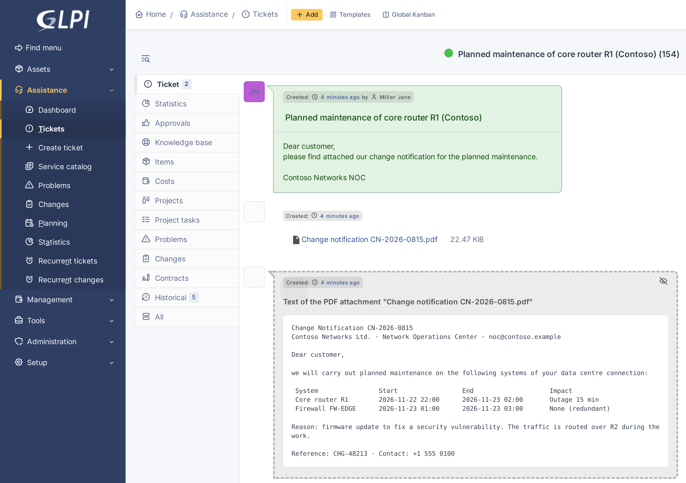
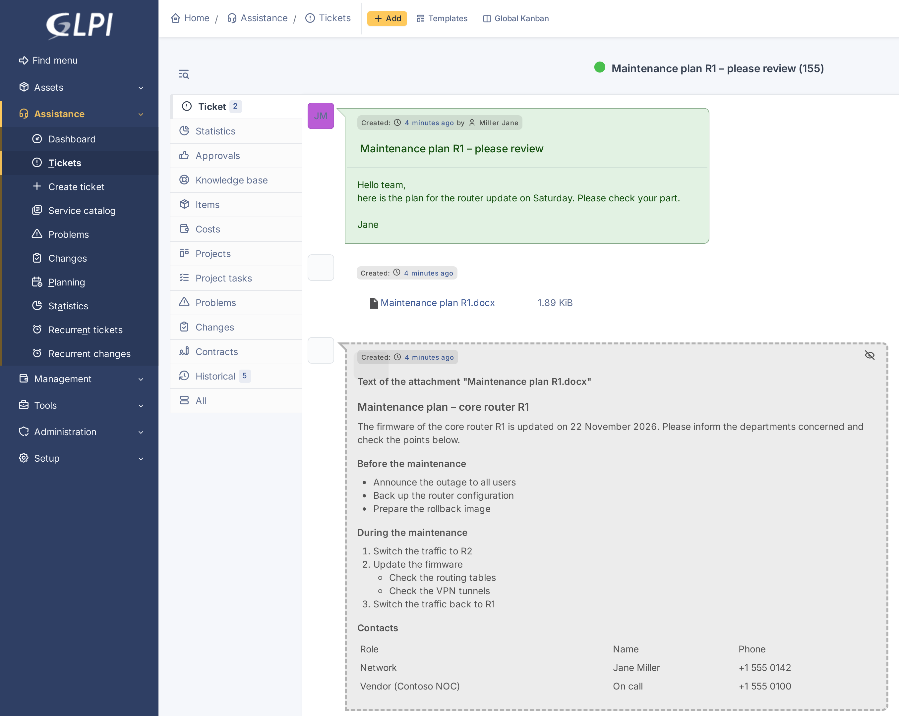
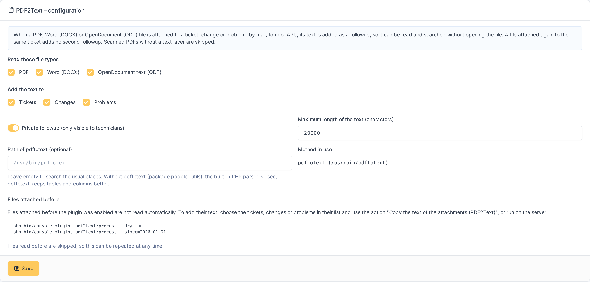

# PDF2Text – GLPI plugin

Copies the text of **PDF, Word (DOCX) and OpenDocument (ODT)** attachments into GLPI **tickets,
changes and problems**, so it can be read in the timeline and found with the search, without
opening the attachment.

Typical use: a third party sends notifications as PDF attachments by mail. The mail collector
creates the ticket, and the plugin adds the text of the PDF as a followup.

## Screenshots

The text of a PDF from the mail collector as a followup, and a Word document with its headings,
lists and table:





The button at each attachment and the settings:




## How it works

- Every time a PDF, DOCX or ODT file is linked to a ticket, change or problem, the plugin reads
  its text and adds it as a **followup** (private by default). This covers:
  - new tickets from the **mail collector** and the web form,
  - **reply mails** and followups, tasks, solutions or approvals with a file (the text goes to
    their ticket, change or problem),
  - documents added through the API.
- PDFs are read with **`pdftotext`** (package `poppler-utils`) if it is installed, which keeps
  tables and columns. Otherwise the bundled PHP parser
  ([smalot/pdfparser](https://github.com/smalot/pdfparser)) is used, so the plugin also works on
  hosting without shell access.
- Word and OpenDocument files are read by the plugin itself (no extra program) and their text is
  added **formatted**: headings, paragraphs, bulleted and numbered lists (also nested) and tables,
  with lines that wrap like any followup. Which paragraphs are headings and whether a list is
  numbered is taken from the styles of the document. Headers, footers, footnotes, comments,
  generated tables of contents and deleted text of tracked changes are left out. PDFs are added
  as a text block in a fixed-width font, so the columns of `pdftotext` stay aligned.
- **No duplicates:** each file is read only once per ticket, change or problem. The same file
  attached again – e.g. a reply mail that quotes the PDF of the first mail – adds no second
  followup. Files are recognised by their checksum, not by their name: a new file with an old
  name (e.g. this month's `report.pdf`) is read. If the text followup is deleted, the file
  counts as not read again.
- **Private files stay private:** if a file is only attached to private followups or tasks
  (or approvals), its text goes into a private followup, also when the setting "Private
  followup" is off.
- **Scanned PDFs** (images without a text layer) are skipped – there is no OCR.
- The followup does **not** send notifications and does **not** reopen solved tickets.
- Problems (unreadable or broken files) are logged to `files/_log/pdf2text.log`; the ticket is
  created in any case.

## Button at the attachment

In the timeline of a ticket, change or problem, GLPI shows buttons when the mouse is over an
attachment (edit, delete, import exclusion list). For PDF, Word and OpenDocument files of the
types switched on, the plugin adds a button **Copy the text into a followup** (icon of a text
file) in front of them:

- A click reads the file and adds its text as a followup; the page is reloaded to show it.
- If the text of this file was added before, the button asks first and adds it again on
  **Add again** (e.g. when the earlier followup was shortened or edited).
- Shown to the users who may add a followup to this ticket, change or problem (the same right as
  GLPI's **Answer**), in the standard and in the simplified interface. Only at the files of this
  object that the user may see there: not e.g. at files of private tasks without the right to
  see private tasks.
- Files without text (e.g. scanned PDFs) and files that cannot be read give a message instead.

GLPI has no hook for these buttons; the plugin adds the button with JavaScript
(`public/js/attachments.js`) on the form pages of tickets, changes and problems.

Searching: in the ticket list, use the search criterion **Followups > Description** (it contains
the text of the files) or the global search.

## Files attached before

Files attached before the plugin was enabled (or while their item type or file type was switched
off) are not read automatically. Their text can be added afterwards; files read before are
skipped, so both ways can be repeated at any time:

- **Massive action:** in the list of tickets, changes or problems, choose the items and use
  **Actions > Copy the text of the attachments (PDF2Text)**. Offered to users who may change the
  GLPI configuration, for the item types switched on in the settings. Afterwards a message says
  how many followups were added and how many files were copied before, had no text or could not
  be read (a warning if a file could not be read).
- **Console command** on the server, in the GLPI directory:

  ```sh
  php bin/console plugins:pdf2text:process --dry-run           # only count what would be read
  php bin/console plugins:pdf2text:process                     # all tickets, changes, problems
  php bin/console plugins:pdf2text:process --since=2026-01-01  # opened on or after this day
  php bin/console plugins:pdf2text:process -t Ticket --id=42   # one ticket
  ```

  Options: `--itemtype` / `-t` (`Ticket`, `Change` or `Problem`; default: the types switched on),
  `--id` (with `--itemtype`), `--since` / `-s` (day `YYYY-MM-DD`), `--limit` / `-l` (number of
  items), `--dry-run`, `-v` (one line per item, also for those without anything new). The exit
  code is 1 if a file could not be read. Run it as
  the user of the web server (e.g. `sudo -u www-data php bin/console …`), so that the log file
  stays writable for GLPI.

Followups written by versions of the plugin before this tracking are recognised as well (by the
file name in their heading and the text block), so these files are not read a second time.

## Requirements

- GLPI 11.0 or later (tested with 11.0.9 and 12.0.0)
- PHP 8.2 or later; for Word and OpenDocument the PHP extensions `zip` and `dom` (both usually
  installed; the configuration page warns if they are missing)
- Recommended: `pdftotext` (`apt install poppler-utils` / `dnf install poppler-utils`)

## Installation

Easiest: download a release archive from the
[releases](https://github.com/developer-labs-lcc/glpi-pdf2text/releases), with all dependencies:

- `pdf2text.zip`: copy it into your GLPI `plugins` directory and unpack it there by double-click
  (or `unzip pdf2text.zip -d pdf2text`). The files are directly in the ZIP, so the new directory
  is named after the file: `plugins/pdf2text`.
- `glpi-pdf2text-<version>.tar.bz2`: contains the directory `pdf2text`; unpack it in the `plugins`
  directory (`tar -xjf glpi-pdf2text-<version>.tar.bz2`).

From the source code:

```sh
cd /var/www/glpi/plugins            # your GLPI plugins directory
git clone https://github.com/developer-labs-lcc/glpi-pdf2text.git pdf2text
cd pdf2text
composer install --no-dev
```

The directory must be named `pdf2text` (the technical key of the plugin). Then enable the plugin in
**Setup > Plugins** (install, then enable).

The plugin creates one table, `glpi_plugin_pdf2text_processedfiles`: which file (checksum) was read
for which ticket, change or problem, and the followup with its text. Uninstalling removes it
together with the settings.

## Configuration

**Setup > Plugins > PDF2Text** (requires the right to change the GLPI configuration):

| Setting | Default | Meaning |
|---|---|---|
| Add the text to | Tickets, Changes, Problems | Item types the text is added to |
| Read these file types | PDF, Word (DOCX), OpenDocument text (ODT) | File types that are read |
| Private followup | on | Followup visible to technicians only |
| Maximum length of the text | 20000 | Longer texts are shortened; the full text stays in the file |
| Path of pdftotext | empty | Empty = search `/usr/bin`, `/usr/local/bin`, `/opt/homebrew/bin` |

The page also shows which method (pdftotext or PHP parser) is used for PDFs, and how to add the
text of files attached before.

## Limits

- The PHP parser only reads PDFs up to 20 MB; larger ones need `pdftotext`.
- `pdftotext` is stopped after 30 seconds.
- A file that would need more memory than PHP's `memory_limit` leaves (PHP parser, Word and
  OpenDocument) is skipped and logged instead of stopping PHP – e.g. in the mail collector.
- Word and OpenDocument files whose text is larger than 20 MB unpacked are not read.
- Formatting within a line (bold, italics, colours, links) and images are not taken over.
- Files that need a password to open, the old Word format (`.doc`), spreadsheets,
  presentations and images are not read.

## Reporting bugs

Please use the form under
[Issues > New issue](https://github.com/developer-labs-lcc/glpi-pdf2text/issues/new/choose). It
asks for the versions of PDF2Text, GLPI and PHP and for a step-by-step guide to reproduce the
problem. Please do not attach confidential documents. Security problems are reported privately
under [Report a vulnerability](https://github.com/developer-labs-lcc/glpi-pdf2text/security/advisories/new),
not as a public issue.

## Development

Tests (`composer install` with dev packages first):

```sh
tests/run.sh                 # all tests; the GLPI tests need the plugin installed and active
php tests/php/ExtractorTest.php   # text extraction only, also runs without GLPI
```

`ExtractorTest` also reads the Word and OpenDocument fixtures (`tests/fixtures/change.docx`,
`change.odt`, built by `tests/fixtures/make_office_fixtures.py`: headings, lists, a table and parts
that must be left out). `HandlerTest` boots GLPI and creates its own tickets, changes and documents in the
database of the instance, and purges them at the end; it also covers files attached again, the
processing of files attached before, the console command, the massive action and the button at
the attachments (server side). `ConfigTest` checks the configuration page (saving, access,
CSRF token field only on GLPI 11) and restores the settings afterwards.

Languages: English (`en_GB`, `en_US`), German (`de_DE`), French (`fr_FR`, `fr_CA`, `fr_BE`),
Portuguese (`pt_BR`, `pt_PT`, each translated on its own), Spanish (`es_ES`, `es_419`, `es_MX`,
`es_AR`, `es_CO`, `es_CL`, `es_EC`, `es_VE`, one neutral text), Russian (`ru_RU`), Polish (`pl_PL`)
and Italian (`it_IT`) – the eight languages most used with GLPI according to its telemetry. The
words follow GLPI's own translations (e.g. French "suivi", Brazilian "acompanhamento"). A file for
every regional variant GLPI offers is needed: for a language without a file, GLPI loads the plugin
texts in the default language of the system (e.g. German), while its own texts follow the user's
language. `tests/php/LocalesTest.php` checks that every file has all texts of `locales/pdf2text.pot`,
that GLPI loads them and the plural forms (Russian and Polish have three). After a change of a `.po`
file, compile it with `msgfmt --check -o locales/<lang>.mo locales/<lang>.po` and run
`bin/console cache:clear` in GLPI.

Code style and static analysis follow Teclib's plugin template. They need the plugin in the
`plugins/pdf2text` directory of a GLPI development checkout (`composer install` in GLPI):

```sh
../../vendor/bin/php-cs-fixer fix --dry-run --diff
../../vendor/bin/phpstan analyse
```

### Release

1. Raise the version in `setup.php` (`PLUGIN_PDF2TEXT_VERSION`), add it to `pdf2text.xml`
   (a new `<version>` with `<num>`, one `<compatibility>` per GLPI major version, e.g.
   `~11.0.0` and `~12.0.0`, and `<download_url>`) and describe it in `CHANGELOG.md`.
2. `tools/release.sh` builds `dist/glpi-pdf2text-<version>.tar.bz2` and, with the same content
   but without the parent directory, `dist/pdf2text.zip`.
3. Create a GitHub release with the tag `<version>` and attach both archives.

The plugin catalog ([plugins.glpi-project.org](https://plugins.glpi-project.org/), shown in
GLPI's **Marketplace**) reads `pdf2text.xml` from the `main` branch
(`https://raw.githubusercontent.com/developer-labs-lcc/glpi-pdf2text/main/pdf2text.xml`) and
checks it regularly: new versions appear there without a new submission. The file follows the
format of the catalog: logo 40 × 40 pixels, short descriptions as plain text, long descriptions
in Markdown.

### File headers

Every file starts with a header (comment) naming the plugin, the address of the developer,
copyright, license, the version of the file and its dates:

```php
/**
 * PDF2Text – copies the text of PDF, Word and OpenDocument attachments into GLPI tickets, changes and problems.
 *
 * @link      https://developer-labs.com/en/glpi-development/
 * @copyright Developer Labs LLC
 * @license   GPL-3.0-or-later – see LICENSE
 * @version   1.0.1
 * @created   2026-10-22
 * @changed   2026-11-15
 */
```

`@created` is the day the file was created. Until the file has been committed for the first time,
it stays at version 1.0.0 without `@changed`, however often it is edited. After that, a changed
file gets `@changed` with the day of the last change and a higher `@version` (each file has its
own version, starting with 1.0.0):

- last digit + 1 (1.0.0 → 1.0.1): bug fixes and small changes,
- middle digit + 1 (1.0.1 → 1.1.0): larger changes,
- first digit + 1 (1.1.0 → 2.0.0): the file was extended a lot or rewritten.

## License

Author: AI & Developer Labs LLC

GPL-3.0-or-later, see [LICENSE](LICENSE). © Developer Labs LLC
